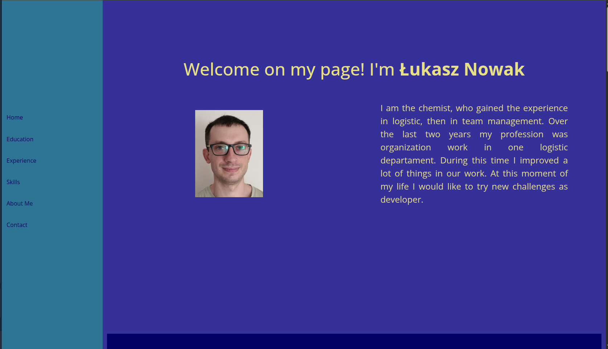
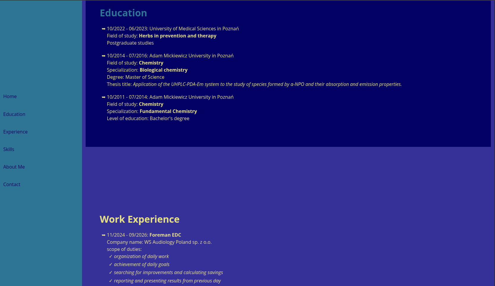
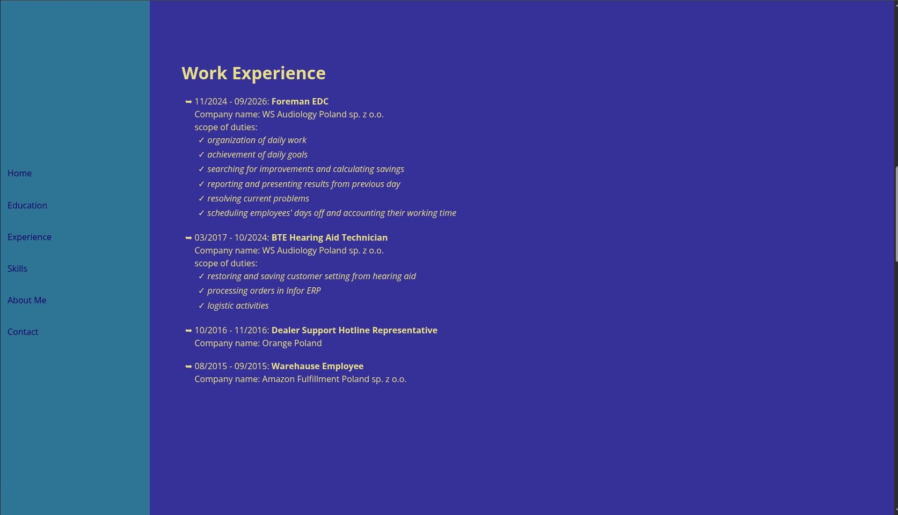
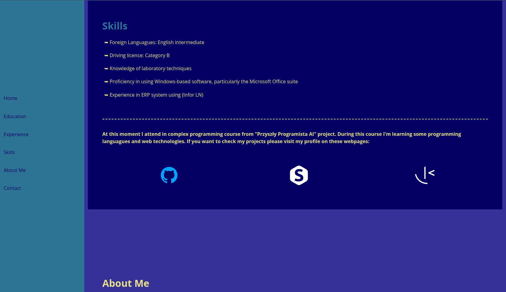
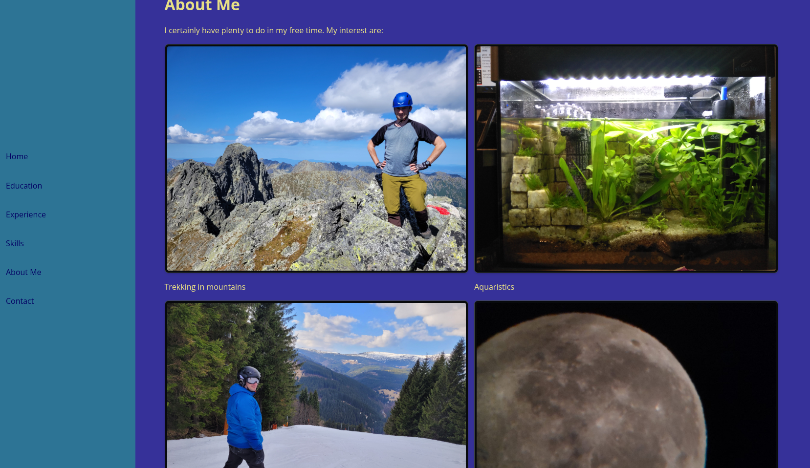
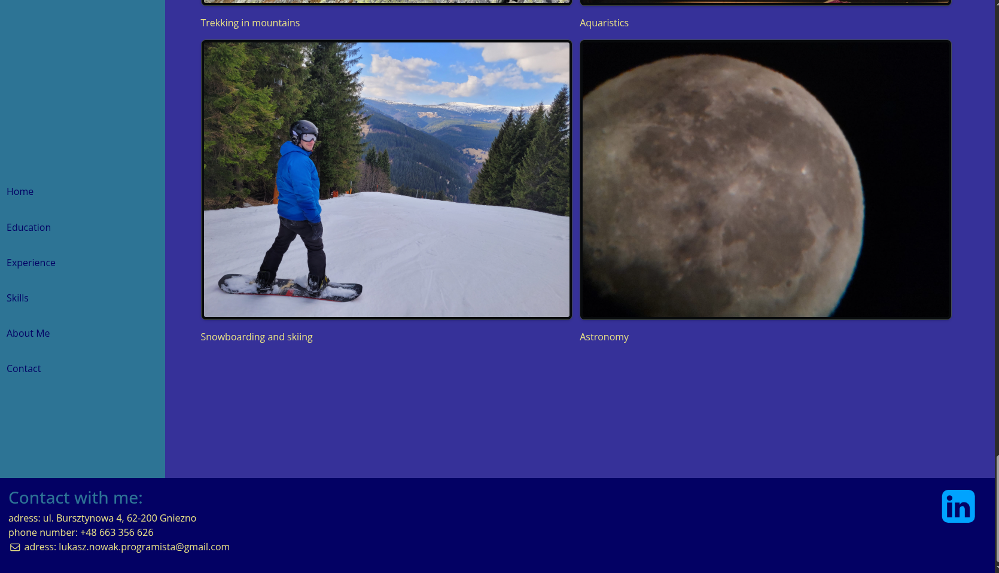
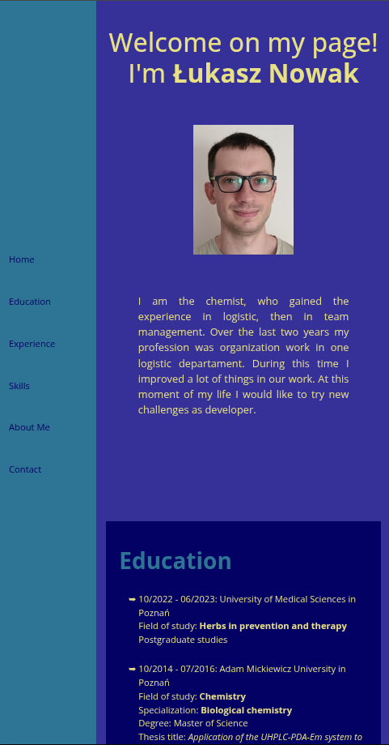

# Capstone Project - Personal Website

This is a solution to the course from udemy.com entitled "Become a Full-Stack Web Developer with just ONE course. HTML, CSS, Javascript, Node, React, PostgreSQL, Web3 and DApps".

## Table of contents

- [Overview](#overview)
  - [The challenge](#the-challenge)
  - [Screenshot](#screenshot)
- [My process](#my-process)
  - [Built with](#built-with)
  - [What I learned](#what-i-learned)
  - [Continued development](#continued-development)
  - [Useful resources](#useful-resources)
- [Author](#author)
- [Acknowledgments](#acknowledgments)

## Overview

### The challenge

Deliverables

- One HTML file for the structure of the website
- One CSS file for the styling of the website
- Any additional assets (e.g. images) used in the website

Features

- A hero section that provides a brief introduction to you and your background.
- A resume page that lists your education, work experience, skills, and other  relevant information (you can link to Capstone project 1).
- A section that showcases any projects or work that you have done in the past.
- An about me section that provides additional information about you and your interests.
- A contact me section that includes information for users to get in touch with you.

Technical Requirements

- All HTML should be valid and follow proper semantic markup.
- All CSS should be valid and follow best practices for naming conventions and organization.
- The website should be responsive and work on different screen sizes and devices.
- All images used in the website should have appropriate alt text to be accessible.

### Screenshot

## My process

### Built with

- Semantic HTML5 markup
- CSS custom properties
- Bootstrap 6.0
- Flexbox
- CSS Grid

### What I learned

I learned how I can use Bootstrap framework in my project. Additionaly I tried to build my first website with an attractive design.

### Continued development

I will be learning how I can use other components from Bootstrap 6.

### Useful resources

- https://miroslawzelent.pl/kurs-bootstrap/
- https://getbootstrap.com/docs/6.0/

## Author

- Github - [Łukasz Nowak](https://github.com/lukasz-nowak44)

## Acknowledgments

Thanks for Artur and team from https://projekt.przyszlyprogramista.pl/
